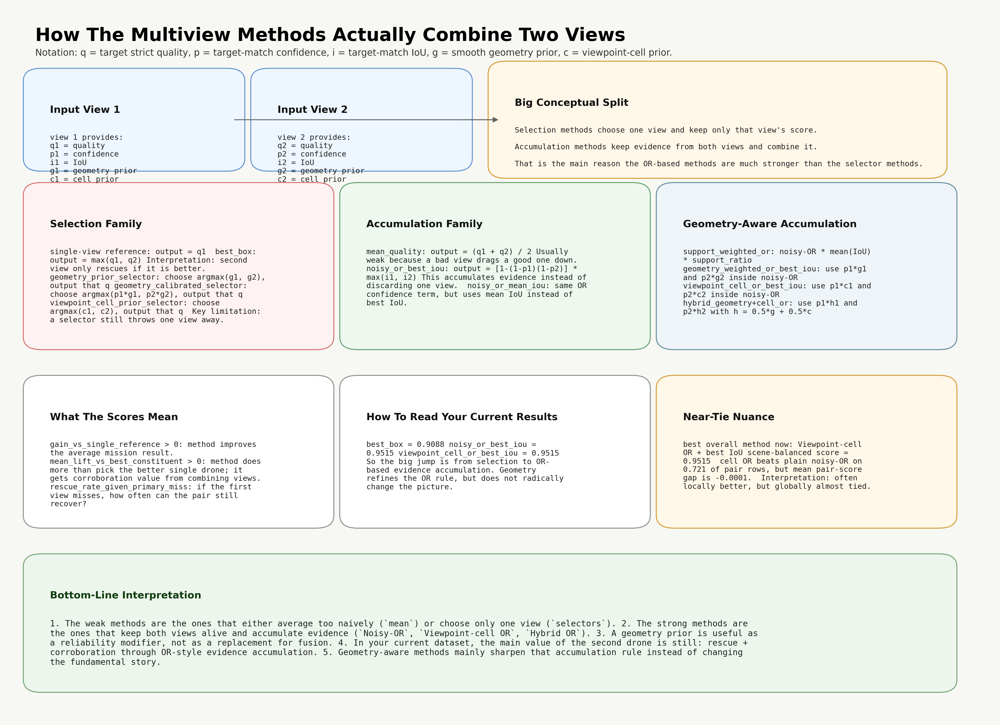

# Comparing Multiview Fusion Methods

## Overview

When two UAVs observe the same object, there are several ways to use their predictions. The simplest approach is to select the better observation, but it is also possible to combine information from both views.

Here, I compared several methods to see whether combining observations improves detection quality, and whether information about the camera-object geometry adds anything beyond standard confidence fusion.

## Methods

The methods differ mainly in how they use the two observations.

**Single-view selection** provides a reference by using only one observation. The best-box method extends this by selecting the observation with the highest target quality. Other selection methods use geometric information or class-specific viewpoint reliability to decide which observation to keep.

**Mean quality** takes the average quality of both observations. Although simple, this can be less useful when one viewpoint provides a good observation and the other does not.

**Noisy-OR + best IoU** combines the confidence scores from both observations while retaining the best localization quality. This allows information from both views to contribute to the final score.

I also evaluated several variations of this approach. Support-weighted OR uses a more conservative combination, while geometry-weighted OR and viewpoint-cell OR adjust the confidence scores using geometric information or previously estimated viewpoint reliability. The hybrid method combines both types of weighting.

## Results

The clearest improvement came from combining observations rather than selecting only one.

The best-box method achieved a mean expected quality of **0.9088**, compared with **0.9515** for Noisy-OR + best IoU.

Adding viewpoint-dependent weights made surprisingly little difference. Viewpoint-cell OR + best IoU obtained the highest mean score, but its advantage over standard Noisy-OR was less than 0.00001.

The pairwise results show a slightly different pattern. Viewpoint-cell OR performed better than Noisy-OR in approximately 72% of the evaluated pairs, but its average pairwise score difference was slightly negative (-0.000078). In other words, it improved many individual comparisons by a small amount, while some larger decreases offset those gains.

## Interpretation

The results suggest that most of the improvement comes from making use of both observations, rather than from the additional geometric weighting.

This is particularly interesting because the geometry-based methods use information about which viewpoints are expected to perform well. However, knowing which viewpoint is likely to be better does not necessarily mean that selecting or weighting it will outperform simply combining the available predictions.

The difference between Noisy-OR and viewpoint-cell OR is also a useful reminder that a method can win more individual comparisons without improving the average result by much.

Overall, the standard Noisy-OR approach performed well without requiring additional viewpoint-specific information. Geometry-aware weighting changed the results, but its added value was limited in this evaluation.

## Related Files

The detailed results can be found in:

* `overall_method_summary.csv` — Mean performance across the evaluated methods.
* `method_value_summary.csv` — Improvement relative to the best individual observation.
* `pairwise_method_comparison.csv` — Direct comparisons between fusion methods.
* `added_viewpoint_headlines.csv` — Contributions of additional viewpoints.
